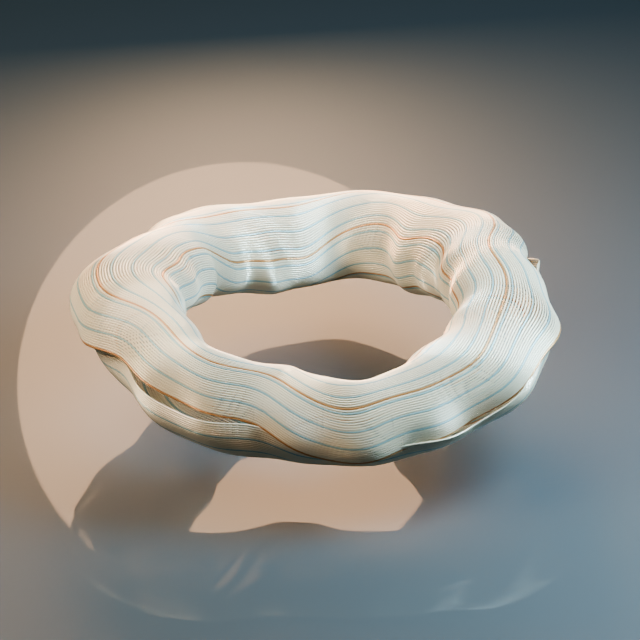

# Abstract fiber and pulse study — Hx Works

A self-initiated, code-authored Blender study of a folded fiber ring, material response and subtle periodic deformation. This is original generic abstract imagery, with no client assets or medical accuracy claim.



[Rest phase, frame 1](renders/phase-001.png) · [Maximum deformation, frame 49](renders/phase-049.png)

The scene contains 112 tube strands, 172,032 mesh vertices, three editable fiber materials, two shape keys and a scripted shape-key driver. The native scene was saved and reopened in Blender 5.2.1 LTS before checking its structure and evaluated vertex positions. Sampled pulse weights at frames 1, 25, 49 and 97 were 0, approximately 0.5, 1 and 0.

The included 640 × 640 PNGs show three phase samples. The main still and frame 25 show the same phase. They are CPU Cycles renders with 16 samples; they do not demonstrate a completed animation, playback smoothness, production-resolution rendering or a customer's approved visual style.

## Rebuild

Requires Blender with its bundled Python. No additional packages, textures, fonts or network access are required.

```sh
blender --background --factory-startup --python rebuild_abstract_study.py
```

The script writes under `local-output/`, saves and reopens a native scene, checks its structure and renders four images. Use only PNG copies from `local-output/public-stills/` for sharing: the script removes text and EXIF metadata while preserving compressed image data. Raw renders, native files and local receipts are not part of this public example.

The final script was actually executed on Blender 5.2.1 LTS using eight CPU threads: four renders completed in 18.511 seconds of script time. This measures this small local run; it is not a delivery estimate or a full accounting of tool and computing costs. Other Blender versions and customer import pipelines were not tested.

## Scope and licensing

The self-authored Python script is licensed under GNU GPL version 3 or later, as stated in its SPDX header; see [COPYING](COPYING). That script license does not automatically determine rights in rendered artwork or scene data. No Blender executable, external plugin or third-party visual asset is distributed. This study is not a paid client case or an offer of exclusive image rights; commissioned scope, source delivery and usage rights require a separate agreement.

Blender licensing: [official license](https://www.blender.org/about/license/) and [official FAQ](https://www.blender.org/support/faq/).
